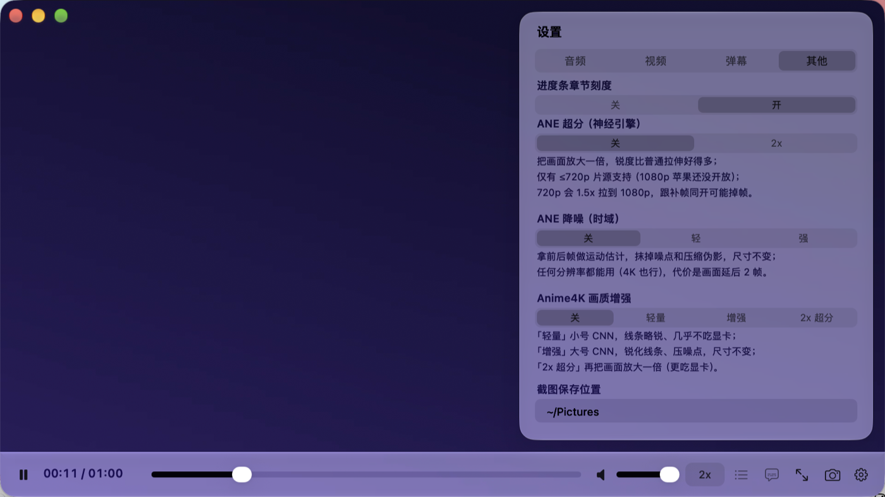
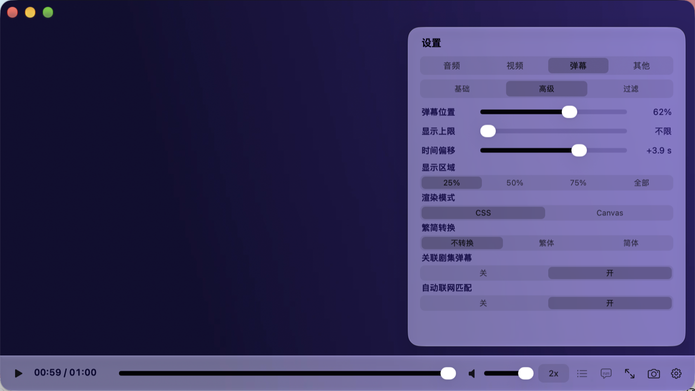

# ANEPlayer

macOS 视频播放器，用 Apple 神经引擎做实时补帧、降噪和超分，带一个可调的弹幕层。

内核是 [mpv](https://github.com/mpv-player/mpv) 的 libmpv，UI 用 ObjC + AppKit 写。三个自定义滤镜调用 macOS 26 的 `VTFrameProcessor`，接在解码后面。

代码主要是 AI 写的，说明见[关于这个项目](#关于这个项目)。



## 功能

**画质**

- 补帧 2x / 4x — `VTLowLatencyFrameInterpolation`
- 时域降噪 轻 / 强 — `VTTemporalNoiseFilter`，尺寸不变
- 超分 2x — `VTLowLatencySuperResolutionScaler`，仅 ≤720p 源
- Anime4K 四档 — 关 / 轻量 / 增强 / 2x 超分

**弹幕**

- 弹弹play 自动匹配（文件名 + 指纹）和手动搜索，结果缓存在本地
- 字号、速度、不透明度、描边、显示上限、时间偏移
- 显示区域四档，可整体上下偏移，能推入黑边
- 屏蔽词（包含 / 整条）、纯重复过滤、同文去重



**界面**

- 液态玻璃面板（`NSGlassEffectView`），选中态不用系统蓝
- 单击收控制条，双击全屏
- `,` `.` 调音量，空格长按临时加速
- 截图、播放信息、章节刻度、窗口置顶

## 系统要求

| | |
|---|---|
| 系统 | macOS 26+（`VTFrameProcessor` 需要） |
| 芯片 | Apple Silicon。Intel 上滤镜自动直通，能播但没加速 |
| 工具链 | Xcode Command Line Tools、`meson`、`ninja`、`pkg-config`、`ffmpeg` |

```bash
brew install meson ninja pkg-config ffmpeg
```

## 下载

[Releases](https://github.com/applemiku/ANEPlayer/releases) 里有打包好的 `.zip`，解压后把 `ANEPlayer.app` 拖进「应用程序」。

没有公证，首次打开会被 Gatekeeper 拦一下，任选一种：

```bash
xattr -dr com.apple.quarantine /Applications/ANEPlayer.app
```

或者右键图标 →「打开」→ 再点一次「打开」。

## 构建

```bash
git clone https://github.com/applemiku/ANEPlayer.git
cd ANEPlayer

# 1) 编译带 ANE 滤镜的 libmpv（克隆 mpv v0.41.0 并打补丁）
./scripts/build-libmpv.sh

# 2) 打包 app
./build.sh

open build/ANEPlayer.app
```

已经有现成的 libmpv（含 `include/mpv/`）可以直接指定：

```bash
MPV_LIB_DIR=/path/to/libmpv ./build.sh
```

## 快捷键

| 键 | 作用 | 键 | 作用 |
|---|---|---|---|
| 空格 | 播放 / 暂停（长按 1.5x） | `f` / ⌘F | 全屏切换 |
| ← / → | 后退 / 前进 5 秒 | `m` | 静音 |
| ↑ / ↓ | 音量 ±5% | `a` | 补帧档位循环 |
| `,` / `.` | 音量 −5% / +5% | `s` | 字幕面板 |
| `p` | 设置面板 | `l` | 播放列表 |
| Tab | 播放信息面板 | Esc | 关掉面板 |
| ⌘O | 打开文件 | ⌘S | 截图 |

鼠标：单击画面收控制条，双击全屏，移动唤出控制条。

## 目录结构

```
src/                 ObjC 源码（main.m 是主体，ANEDanmaku 是弹幕层）
assets/anime4k/      Anime4K 着色器（MIT）
assets/danmaku/      弹幕渲染层：WKWebView + niconicomments（MIT）
assets/AppIcon.icns  应用图标（assets/make_appicon.swift 可重新生成）
libmpv-patches/      三个 ANE 滤镜源码 + 自动打补丁脚本
scripts/             构建 libmpv
build.sh             打包 app
stage_deps.py        把非系统 dylib 收进 bundle 并改写 @rpath
```

## 已知限制

- 补帧 / 降噪 / 超分需要 macOS 26 + Apple Silicon，其他环境自动直通
- 补帧 4K 源会掉帧
- 弹幕依赖弹弹play 公共接口，对方改动时可能失效
- 只在 arm64 + macOS 26/27 上测过

## 关于这个项目

代码主要是 AI 生成的。人负责定需求、装上试、报问题、决定改不改。

写得不够整齐：

- 同一个功能在不同时期写的，`updateXxx` 和 `refreshXxx` 混用
- 注释少，复杂分支（比如 seek 防抖的计时器）只写了结论，原因得翻 commit
- 只覆盖了手头的片源和 macOS 26/27，冷门容器、DRM、多显示器切换没测

要改的话先看 `src/main.m` 的状态机和 `libmpv-patches/vf_ane.m` 的滤镜生命周期，这两块最容易踩坑。补帧滤镜之前漏了 `VTFrameProcessorFrame` 的释放，播一部片子吃掉几个 G 内存。

## 许可与版权

GPL-3.0。项目链接了 GPL 版 libmpv 和 Homebrew 的 FFmpeg，只能这么发。可以自用、修改、再分发，分发修改版时把源码一起开出来。

每个 Release 的 `.app` 对应仓库里同一 tag 的源码，也就是这里的代码。

仓库和二进制里没有影片、字幕、字体或弹幕文本。弹幕从弹弹play 实时拉取，版权归原作者，这里不存不转。

第三方组件：mpv / FFmpeg（GPL）、Anime4K（MIT）、niconicomments（MIT）、弹弹play 接口。逐条见 [THIRD-PARTY-NOTICES.md](THIRD-PARTY-NOTICES.md)。

软件按现状提供，不担保。播什么、从哪来，是使用者自己的事。

图标和截图是本项目自己做的。

## 致谢

- [mpv](https://github.com/mpv-player/mpv) / FFmpeg — 播放内核
- [Anime4K](https://github.com/bloc97/Anime4K) — 着色器
- [niconicomments](https://github.com/xpadev-net/niconicomments) — 弹幕渲染
- 弹弹play — 弹幕数据
